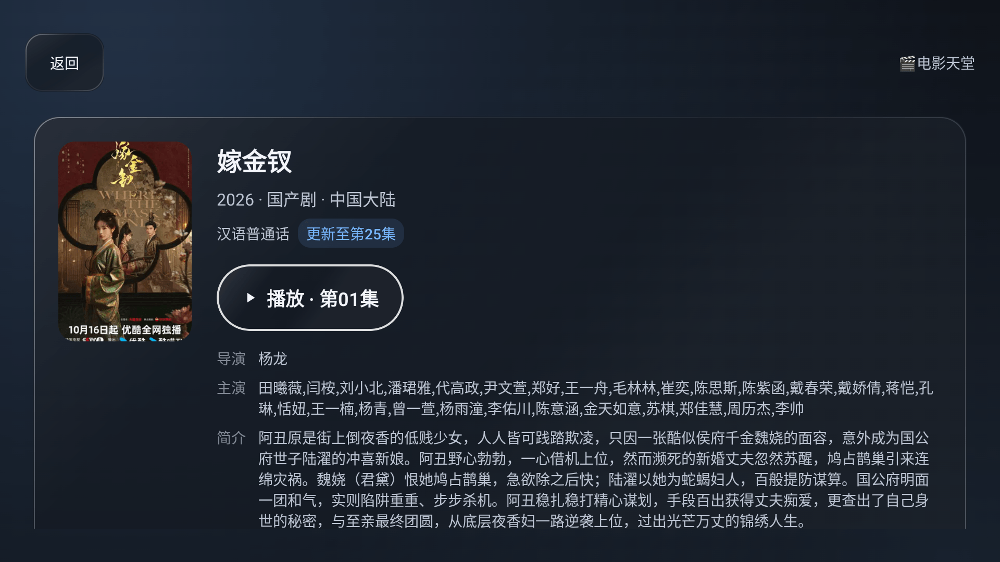

<p align="center">
  
</p>

# 小老虎爱看剧（TigerTV）

TigerTV 是支持多来源搜索、影视播放、智能弹幕匹配和 HLS 去广告的开源项目。长期维护 Android TV、Web/PWA 和原生命令行。macOS SwiftUI 原生客户端已停止开发与维护，原代码留作参考。macOS、Windows 和 Linux 的图形界面统一使用 Web/PWA。

| 功能 | Android TV | Web/PWA | CLI |
|---|---|---|---|
| 多源搜索、聚合、详情 | 支持 | 浏览器直连，可选元数据 Gateway | 支持 |
| 豆瓣推荐 | 直连 | 直连可用时更新，附带静态快照 | — |
| 选集、自动下一集、最近播放、分集续播、记忆倍速 | 支持 | 支持 | — |
| 智能弹幕和手动选择 | 配置弹幕 API | 配置支持 CORS 的弹幕 API | — |
| HLS 去广告 | Media3，精确规则与启发式补充 | hls.js，精确规则与启发式补充 | — |
| 音量记忆、键盘快捷键、画中画 | 系统音量和遥控器 | 支持，画中画按浏览器能力显示 | — |
| 获取链接、生成 Quantumult X 规则、日志 | — | — | 支持 |

## 截图

### Android TV

<table>
  <tr>
    <td width="50%"></td>
    <td width="50%"></td>
  </tr>
  <tr>
    <td width="50%"></td>
    <td width="50%"></td>
  </tr>
</table>

## 快速开始

### Web/PWA

需要 Node.js 24 或更新版本。在仓库根目录运行：

```bash
npm --prefix web ci
npm --prefix web run dev
```

运行 `npm --prefix web run build` 可将 `web/dist/` 部署到静态 HTTPS 站点。对于元数据受 CORS 限制的来源，也可通过 Docker Compose 部署可选 Gateway。浏览器支持时，可将 TigerTV 安装为 PWA。媒体由浏览器直连资源站 CDN。各来源的搜索、详情及媒体兼容性以实测为准。 [Web 开发与兼容性](docs/development/web.md)

### Android TV 应用

1. 从 [Releases](https://github.com/qvshuo/TigerTV/releases) 下载 `TigerTV-AndroidTV-universal.apk`。
2. 将 APK 安装到 Android TV 设备。

**系统要求：** Android 14+。

### 命令行工具

支持 macOS arm64、Linux x86_64 和 arm64，运行无需 JVM。Linux 发布包以 Ubuntu 24.04 为验证基线，依赖 glibc、libcurl 和系统 CA 证书。

一键安装：

```bash
curl -fsSL https://raw.githubusercontent.com/qvshuo/TigerTV/main/skills/scripts/install.sh | bash
```

安装脚本不会修改 PATH。如 `~/.local/bin` 尚未加入 PATH，在 zsh 中可执行：

```bash
echo 'export PATH="$HOME/.local/bin:$PATH"' >> ~/.zshrc
source ~/.zshrc
```

#### 常用命令

```bash
# 搜索剧集
tigertv search 嫁金钗

# 获取播放 / 下载链接：使用搜索结果中的完整站点名和视频 ID
tigertv fetch --site "🎬站点完整名称" --video-id 73480

# 生成 Quantumult X 直连规则
tigertv quanx 嫁金钗

# 查看日志
tigertv logs
```

也可以通过 `tigertv --config sources.json search 嫁金钗` 使用本地来源配置。

[Agent Skill](skills/SKILL.md) 提供完整的 Agent 工作流；下载剧集另需 `yt-dlp` 和 `ffmpeg`。

## 开发

构建与发布见 [开发说明](docs/README.md)，数据与交互见 [契约](docs/contract.md)，实现约定见 [AGENTS.md](AGENTS.md)。
