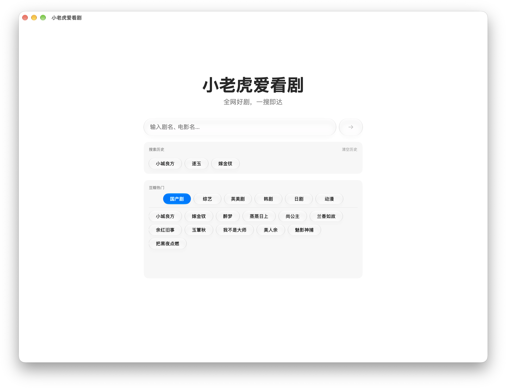
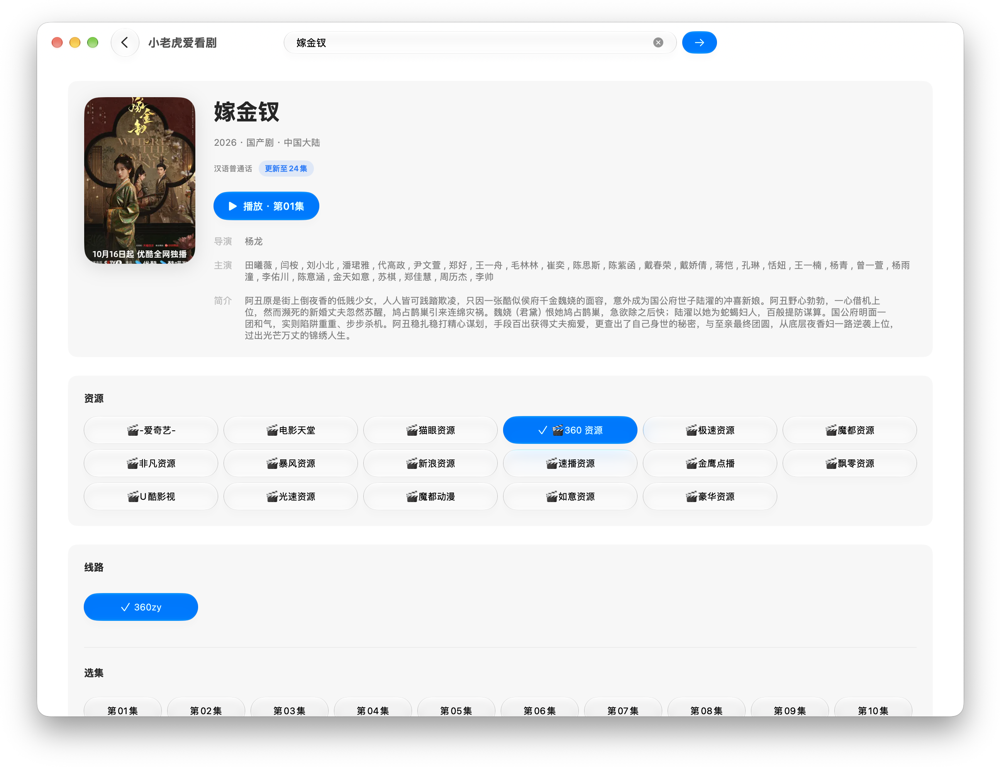
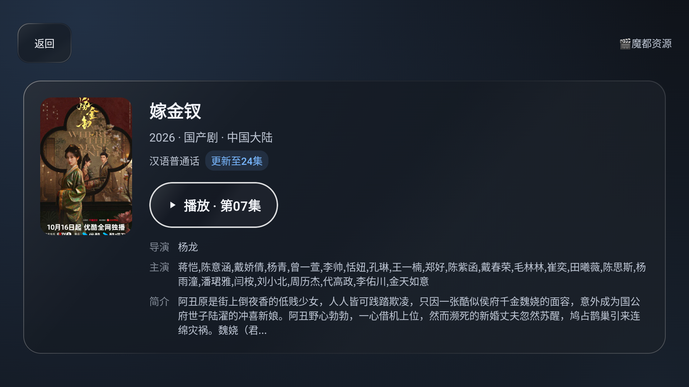

<p align="center">
  
</p>

# 小老虎爱看剧（TigerTV）

跨平台影视搜索与播放工具，包含 macOS 应用、Android TV 应用，以及供用户和 AI Agent 使用的命令行工具。

## 特性

- **macOS 应用**：多源并发搜索，结果返回即展示并聚合，支持液态玻璃与系统明暗模式
- **Android TV 应用**：与 macOS 一致的搜索与播放流程，针对遥控器优化焦点与导航
- **作品详情**：切换资源、线路与选集，按资源记住上次播放的一集
- **豆瓣热门**：国产剧、综艺、英美剧、韩剧、日剧与动漫，点击剧名即可搜索
- **命令行工具**：搜索影视资源、获取播放和下载链接、生成 Quantumult X 直连规则、查看日志
- **Agent Skill**：为 AI Agent 提供影视搜索、链接获取、直连规则生成和下载流程指引

## 截图

### macOS

<table>
  <tr>
    <td width="33%"></td>
    <td width="33%"></td>
    <td width="33%"></td>
  </tr>
</table>

### Android TV

<table>
  <tr>
    <td width="33%"></td>
    <td width="33%"></td>
    <td width="33%"></td>
  </tr>
</table>

## 快速开始

### macOS 应用

1. 从 [Releases](https://github.com/qvshuo/TigerTV/releases) 下载 `TigerTV-macOS-arm64.zip`。
2. 解压并将「小老虎爱看剧」拖入「应用程序」文件夹。

**系统要求：** macOS 26+（Apple Silicon）。

应用目前未签名。如果 macOS 阻止打开，可在终端执行：

```bash
xattr -dr com.apple.quarantine "/Applications/小老虎爱看剧.app"
```

### Android TV 应用

1. 从 [Releases](https://github.com/qvshuo/TigerTV/releases) 下载 `TigerTV-AndroidTV-universal.apk`。
2. 将 APK 安装到 Android TV 设备。

**系统要求：** Android 14+。

从旧签名版本升级时，需要先卸载旧版本。卸载会删除旧版本的应用数据。

### 命令行工具

适用于 macOS（Apple Silicon），使用共享 Kotlin 核心编译为原生可执行文件。

一键安装：

```bash
curl -fsSL https://raw.githubusercontent.com/qvshuo/TigerTV/main/skills/scripts/install.sh | bash
```

安装脚本不会修改 PATH。如 `~/.local/bin` 尚未加入 PATH，在 zsh 中可执行：

```bash
echo 'export PATH="$HOME/.local/bin:$PATH"' >> ~/.zshrc
source ~/.zshrc
```

#### 常用命令

```bash
# 搜索剧集
tigertv search --query 嫁金钗

# 获取播放 / 下载链接：使用搜索结果中的完整站点名和视频 ID
tigertv fetch --site "🎬站点完整名称" --video-id 73480

# 生成 Quantumult X 直连规则
tigertv quanx --query 嫁金钗

# 查看日志
tigertv logs
```

也可以通过 `tigertv --config sources.json search --query 嫁金钗` 使用本地来源配置。[Agent Skill](skills/SKILL.md) 提供完整的 Agent 工作流；下载剧集另需 `yt-dlp` 和 `ffmpeg`。

## 开发

构建与发布见 [开发说明](docs/README.md)，数据与交互见 [契约](docs/contract.md)，实现约定见 [AGENTS.md](AGENTS.md)。
