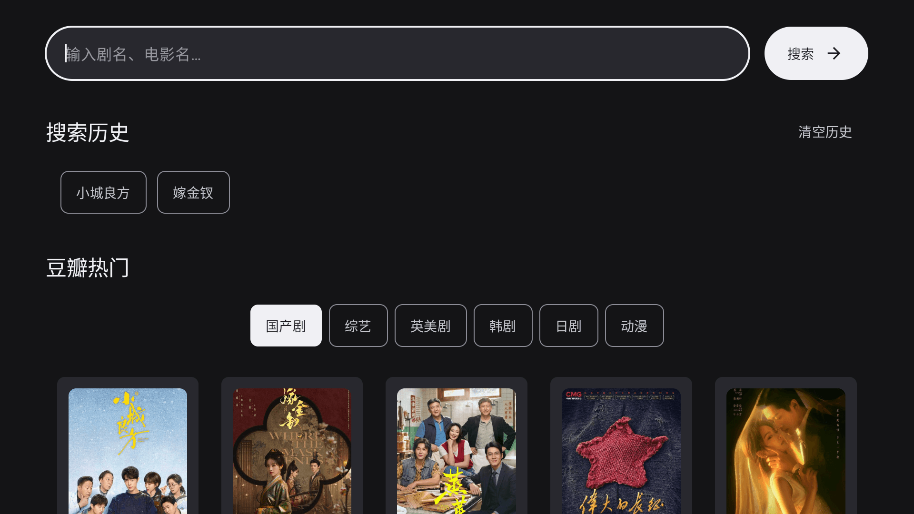
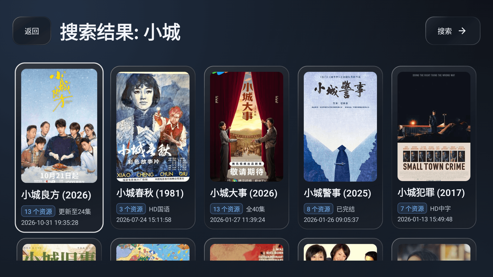
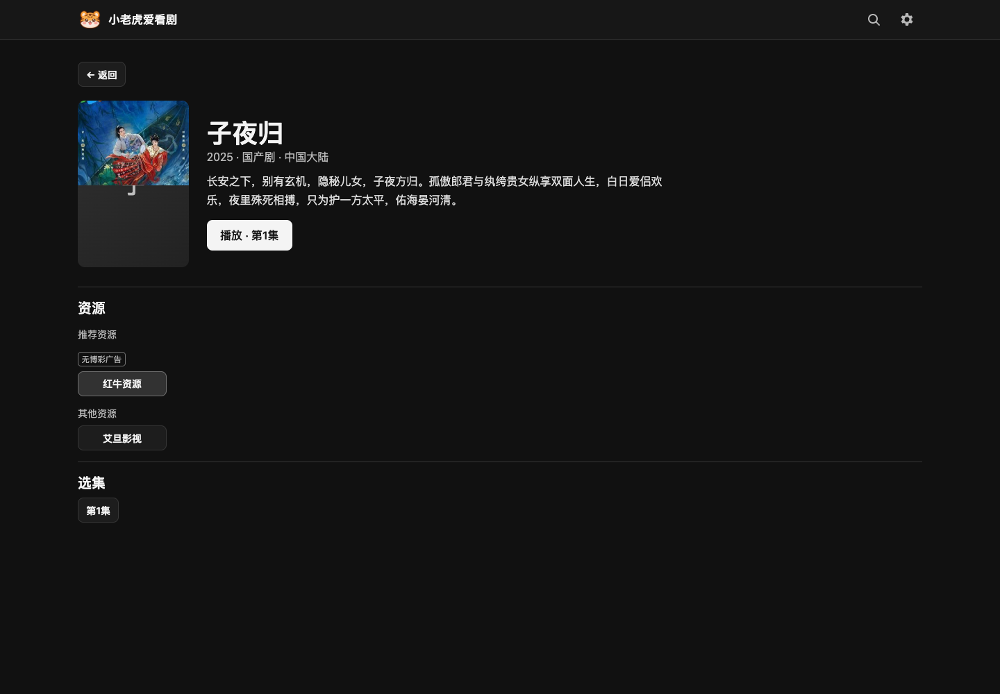

<p align="center">
  
</p>

# 小老虎爱看剧（TigerTV）

跨平台影视搜索与播放工具，包含 Android TV 应用、Web/PWA，以及供用户和 AI Agent 使用的命令行工具。

## 特性

- **Android TV 应用**：适配遥控器的多源搜索、选集与播放
- **Web/PWA**：在桌面和手机浏览器中搜索、播放，支持安装到设备
- **浏览播放**：豆瓣热门推荐、继续观看、自动连播和倍速记忆
- **智能弹幕**：自动匹配弹幕，也可手动选择来源和剧集
- **去广告**：过滤已支持来源中打断剧情的博彩插播
- **命令行工具**：搜索、获取链接、生成 Quantumult X 直连规则、查看日志
- **Agent Skill**：影视搜索、链接获取、直连规则与下载流程指引

Android TV 是主力客户端，Web/PWA 面向桌面和移动端，CLI 继续支持 macOS arm64、Linux x86_64 和 arm64。macOS SwiftUI 客户端永久停止开发，源码已归档。Windows 和 Linux 原生图形客户端不在产品范围内。

## 截图

### Android TV

<table>
  <tr>
    <td width="50%"></td>
    <td width="50%"></td>
  </tr>
  <tr>
    <td width="50%"></td>
    <td width="50%"></td>
  </tr>
</table>

### Web/PWA



## 快速开始

### Web/PWA

安装 Docker Compose 后，在仓库根目录运行：

```bash
docker compose -f web/compose.yaml up -d --build
```

打开 `http://localhost:18811`。浏览器直接播放资源站的视频。弹幕服务单独部署，其地址在设置中填写。浏览器支持时可通过 HTTPS 安装为 PWA。 [共享网络反代、环境变量与兼容性](docs/development/web.md)

### Android TV 应用

1. 从 [Releases](https://github.com/qvshuo/TigerTV/releases) 下载 `TigerTV-AndroidTV-universal.apk`。
2. 将 APK 安装到 Android TV 设备。

**系统要求：** Android 14+。

### 命令行工具

支持 macOS arm64、Linux x86_64 和 arm64，运行无需 JVM。Linux 发布包以 Ubuntu 24.04 为验证基线，依赖 glibc、libcurl 和系统 CA 证书。

一键安装：

```bash
curl -fsSL https://raw.githubusercontent.com/qvshuo/TigerTV/main/skills/scripts/install.sh | bash
```

安装脚本不会修改 PATH。如 `~/.local/bin` 尚未加入 PATH，在 zsh 中可执行：

```bash
echo 'export PATH="$HOME/.local/bin:$PATH"' >> ~/.zshrc
source ~/.zshrc
```

#### 常用命令

```bash
# 搜索剧集
tigertv search 嫁金钗

# 获取播放 / 下载链接：使用搜索结果中的完整站点名和视频 ID
tigertv fetch --site "🎬站点完整名称" --video-id 73480

# 生成 Quantumult X 直连规则
tigertv quanx 嫁金钗 > first.list
tigertv quanx --merge first.list 逐玉 > combined.list

# 查看日志
tigertv logs
```

也可以通过 `tigertv --config sources.json search 嫁金钗` 使用本地来源配置。

[Agent Skill](skills/SKILL.md) 提供完整的 Agent 工作流；下载剧集另需 `yt-dlp` 和 `ffmpeg`。

## 开发

构建与发布见 [开发说明](docs/README.md)，数据与交互见 [契约](docs/contract.md)，实现约定见 [AGENTS.md](AGENTS.md)。
